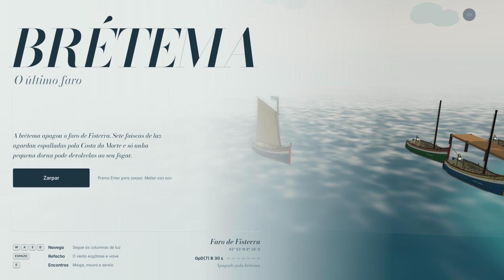
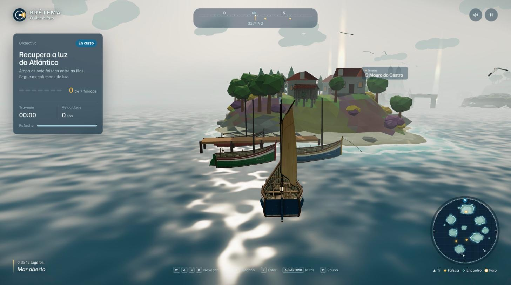
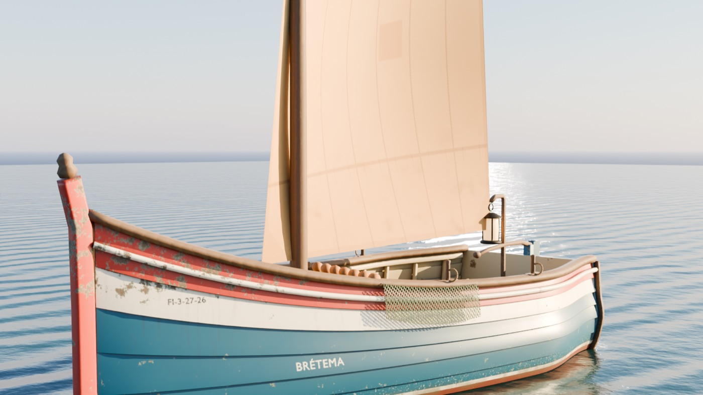
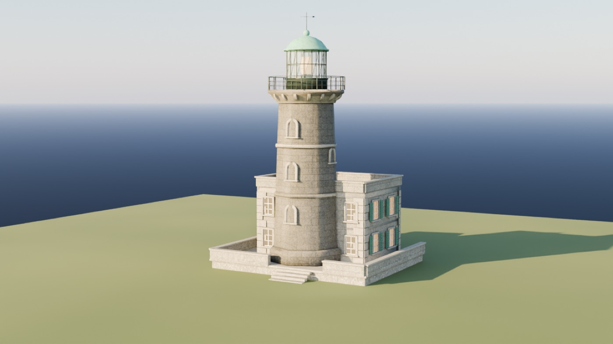
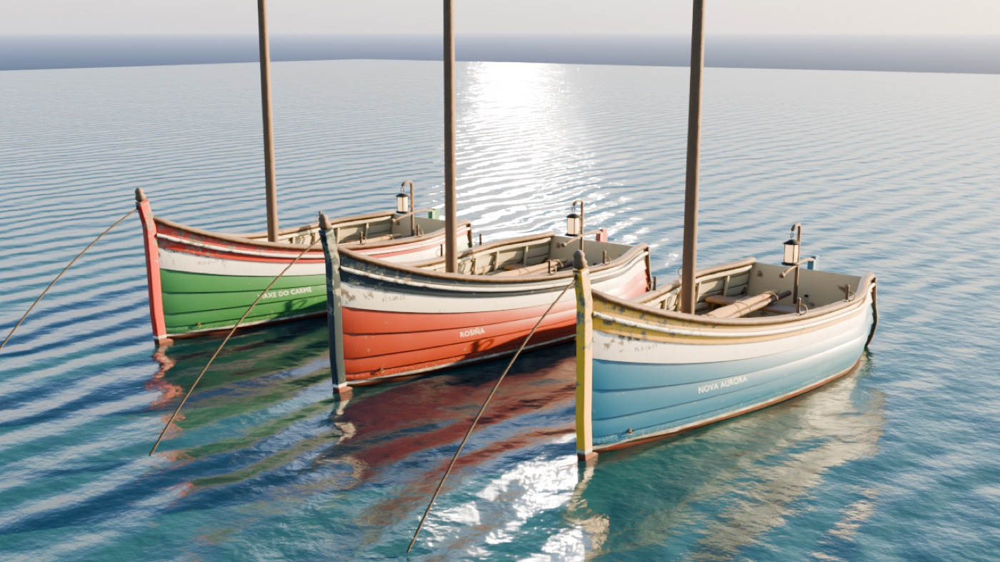
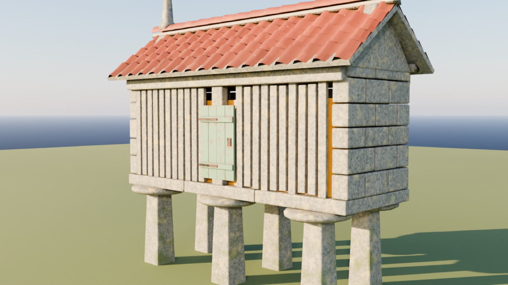
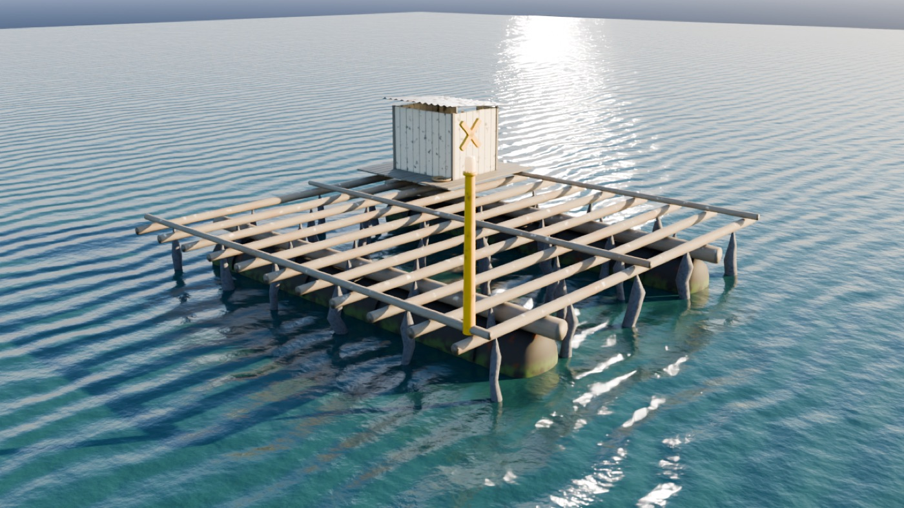
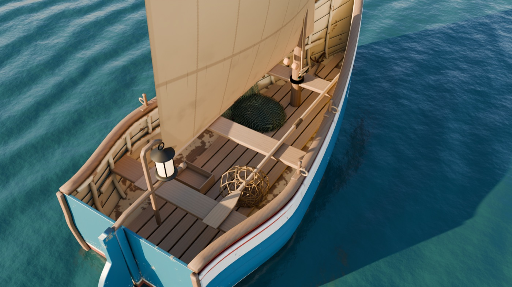

<div align="center">



# BRÉTEMA: O último faro

**Una aventura náutica en 3D por una Costa da Morte de niebla, faros y leyendas.**

*A brétema apagou o faro de Fisterra. Sete faíscas de luz agardan espalladas pola costa<br/>e só unha pequena dorna pode devolvelas ao seu fogar.*


**[▶ Jugar ahora](https://enshetinin.github.io/bretema/)**

[Cómo se juega](#-cómo-se-juega) &nbsp;|&nbsp; [Controles](#-controles) &nbsp;|&nbsp; [Galería](#-galería) &nbsp;|&nbsp; [Jugar en local](#-jugar-en-local) &nbsp;|&nbsp; [Publicar](#-publicar-en-github-pages) &nbsp;|&nbsp; [Por dentro](#-por-dentro)

</div>

---



## 🌊 Cómo se juega

Gobiernas una **dorna**, la pequeña barca de vela de relinga de las rías gallegas, entre islas envueltas en brétema.

1. **Recupera las 7 faíscas.** Las columnas de luz atraviesan la niebla y la brújula marca las más cercanas. Cada faísca vuela hasta el faro y lo hace brillar un poco más, mientras el día pasa de la niebla al atardecer dorado.
2. **Vuelve a Fisterra.** Con las siete en tu poder, entra en el círculo de luz bajo el cantil: el faro se enciende en una secuencia cinemática de hora azul, haces volumétricos y fuegos de luz.

### Encuentros

Tres figuras del folclore te esperan en el mar. Son opcionales, y cada una te regala una mejora:

| | Encuentro | Reto | Recompensa |
|---|---|---|---|
| 🌿 | **A Meiga do Burato**, en Ons | Recoge tres ramos de herbas de San Xoán a la deriva | *Queimada de lume azul*: todas las faíscas aparecen en la carta y la brétema se aclara |
| 🪨 | **O Mouro do Castro**, en Baroña | Cruza los cinco arcos de piedra en orden en menos de 45 s | *Ouro dos mouros*: un refacho un 70 % más largo |
| 🐚 | **A Sereia de Sálvora** | Sigue su canto entre la niebla hasta la vieira | *Vento da sereia*: un 12 % más de velocidad |

## 🎮 Controles

| Acción | Teclado | Mando | Táctil |
|---|---|---|---|
| Vela (avanzar / ciar) | <kbd>W</kbd> <kbd>S</kbd> o <kbd>↑</kbd> <kbd>↓</kbd> | RT / LT o stick | ↑ ↓ |
| Timón | <kbd>A</kbd> <kbd>D</kbd> o <kbd>←</kbd> <kbd>→</kbd> | Stick izquierdo | ↶ ↷ |
| Refacho (impulso) | <kbd>Espacio</kbd> o <kbd>Shift</kbd> | A / RB | REFACHO |
| Hablar | <kbd>E</kbd> o <kbd>Enter</kbd> | X / Y | «Falar…» |
| Mirar alrededor | Arrastrar con el ratón | Stick derecho | Arrastrar |
| Pausa, sonido y reiniciar | <kbd>P</kbd>/<kbd>Esc</kbd>, <kbd>M</kbd> y <kbd>R</kbd> | Start | Botones superiores |
| Indicador de rendimiento | <kbd>F</kbd> | | |

## 🖼️ Galería

Los modelos se construyen por completo con scripts de Blender: geometría procedural, materiales envejecidos horneados a texturas y exportación optimizada para la web.

<table>
  <tr>
    <td width="50%"><br/><sub><b>La dorna</b><br/>Casco en tingladillo, pintura desconchada en capas, nombre y matrícula pintados</sub></td>
    <td width="50%"><br/><sub><b>Faro de Fisterra</b><br/>Torre octogonal de sillería, linterna con lente Fresnel y cúpula de cobre</sub></td>
  </tr>
  <tr>
    <td><br/><sub><b>Porto do Son</b><br/>Tres dornas hermanas, cada una con su color, su nombre y su desgaste</sub></td>
    <td><br/><sub><b>Hórreo</b><br/>Granito con líquenes, lousas con el maíz asomando y tejado de teja curva</sub></td>
  </tr>
  <tr>
    <td><br/><sub><b>Batea</b><br/>Emparrillado de eucalipto, flotadores de acero y cuerdas de mejillón</sub></td>
    <td><br/><sub><b>A bordo</b><br/>Bancos, nasas de mimbre, redes con corchos, cabos y fateixa</sub></td>
  </tr>
</table>

## ⚓ Jugar en local

No hay nada que instalar ni compilar: el juego es HTML, CSS y módulos de JavaScript, y funciona sin conexión. Solo necesita un servidor estático, porque los módulos no cargan desde `file://`:

```bash
git clone https://github.com/enshetinin/bretema.git
cd bretema
python3 -m http.server 8000
```

Abre **http://localhost:8000** y pulsa **Zarpar**.

> [!TIP]
> Añade `?procedural` a la URL para jugar con la geometría generada en tiempo real en lugar de los modelos de Blender.

## 🚀 Publicar en GitHub Pages

El repositorio incluye un workflow que publica el juego automáticamente.

1. En **Settings → Pages → Build and deployment** del repositorio, elige **Source: GitHub Actions** (solo la primera vez).
2. Cada `push` a `main` publica el juego en **https://enshetinin.github.io/bretema/**.

## 🔭 Por dentro

**Un mundo hecho de código.** Islas, acantilados, vegetación, aldeas, mar, cielo, música y efectos de sonido se generan en el navegador; los modelos detallados salen de generadores procedurales de Blender.

- **Mar** con shader propio: bajíos turquesa, espuma de orilla, destellos, fresnel y el haz del faro reflejado. Las olas son analíticas e idénticas en JavaScript y GLSL, así que barcos y bateas cabalgan exactamente el mismo oleaje que se ve.
- **Navegación** con física de quilla, deriva en las viradas, timón que necesita agua y un refacho con resistencia.
- **Atmósfera** que avanza con la partida: brétema, nubes instanciadas, sol, estrellas y un guion de color de la niebla al atardecer.
- **Audio procedural** con Web Audio: música, viento, mar y efectos, sin un solo archivo de sonido.
- **Rendimiento**: vegetación instanciada con LOD, arquitectura fusionada, partículas en pool, modelos comprimidos con meshopt y texturas WebP, y calidad automática que se adapta al dispositivo.
- **Interfaz «Atlántico Libre»**: carta náutica, brújula de franja y el faro de Fisterra con su característica real, `GpD(7) B 30 s`: siete destellos, uno por faísca.

### Estructura

```
├── index.html          Pantallas, HUD y pictogramas SVG
├── styles/             Tokens de diseño y estilos
├── src/                Juego: mundo, mar, barco, atmósfera, audio, interfaz…
├── assets/
│   ├── fonts/          Tipografías Inter y Bodoni Moda
│   └── models/         Modelos .glb generados en Blender
├── vendor/three/       Three.js r180
├── tools/
│   ├── blender/        Generadores procedurales de los modelos
│   └── models/         Optimizador de GLB (meshopt + WebP)
└── docs/images/        Imágenes de este README
```

### Desarrollo

```bash
npm install            # instala Biome (JavaScript, CSS, HTML, JSON)
npm run format         # formatea todo; el Python de tools/blender con Ruff vía uvx
npm run format:check   # comprueba el formato
```

Los modelos se regeneran con Blender 5.2 y se optimizan con `tools/models/optimize.js`. Los pasos están en [`tools/blender/README.md`](tools/blender/README.md).

---

<div align="center">
<sub>Hecho con Three.js, Blender y mucha brétema en la Costa da Morte, Galicia</sub>
</div>
